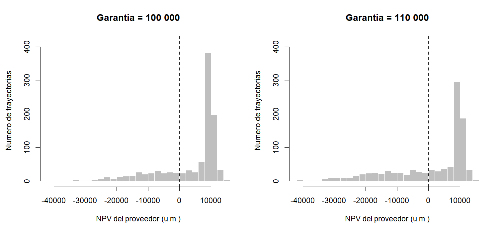

```{r}
#| include: false
# Librerías y parámetros
source("cod/librerias.R")
source("cod/Parametros.R")

```

```{r}
#| include: false
# Lectura y depuración
source("cod/limpieza_data.R") %>% capture.output() %>% invisible()

#Lectura funciones:
source("cod/Funciones.R") %>% capture.output() %>% invisible()

```

```{r}
source("cod/Inciso_A.R") %>% capture.output() %>% invisible()
source("cod/Inciso_C.R") %>% capture.output() %>% invisible()
source("cod/Inciso_D.R") %>% capture.output() %>% invisible()
source("cod/Calculo_adicional_Ronda.R") %>% capture.output() %>% invisible()

```


## C. Flujos, reservas suministradas y profit testing

```{r}
#| label: tbl-inciso-c
#| echo: false
#| message: false
#| warning: false
#| results: asis

tabla.resultados %>%  
  transmute(
    Año = anio,
    `Resv. Inicial` = Reserva.t.1 / 1e6,
    Primas = Primas.anual / 1e6,
    Gastos = Gastos.anual / 1e6,
    Comis. = Comisiones.anual / 1e6,
    Beneficios = Beneficios.anual / 1e6,
    `Resv. Final` = Reserva.t / 1e6,
    Resultado = Resultado.cartera / 1e6
  ) %>%  
  mutate(
    across(
      -Año,
      \(x) format(round(x, 2),
               big.mark = ".",
               decimal.mark = ",")
    ))%>%
  kable(
    digits = 1,
    caption = "Tabla anual de flujos, reservas y resultados cartera (MM u.m.)",
    align = c("l","c","c","c","c","c","c","c","c")
  )
```

Para el **tercer año de proyección** se parte de los activos vigentes al inicio del año y de los supuestos establecidos para **primas, gastos, comisiones, mortalidad, rendimiento y reservas**. El resultado económico se calcula mediante la metodología de *profit testing*: 


$$ \Pi_t = A_t(1+j) - Beneficios_t - Reservas_t$$
donde:
$$\qquad A_t= Reserva_{t-1}+Primas_t-Gastos_t-Comisiones_t$$
Son los recursos iniciales al inicio del año, la reserva inicial tiene un efecto positivo sobre el resultado porque forma parte de los recursos disponibles al inicio del año y genera rendimiento junto con las primas.

Para calcular el resultados de la cartera cálculamos los montos totales con las pólizas vigentes al inicio del año tres, de modo que: $\quad A_3$ = 3.358,65 + 4.798,086 - 959,62 - 239,90 \

Los recursos netos se invierten al rendimiento esperado del 5%: $\quad A_3(1.05)$ = 7.305,074 \
Esto representa el monto disponible en millones de u.m al cierre del año, antes de reconocer siniestros y reservas finales.

```{=typst}
#pagebreak()
```

El costo esperado de fallecimientos se obtiene como:
$$Beneficios_3=D_3\times S$$
donde: \
$\qquad D_3:\quad$fallecimientos esperados en el año 3 (995), \


$\qquad S:\quad$el monto de beneficio por fallecimiento (5 000 000 u.m) \
Este monto se resta porque constituye una salida de recursos para la aseguradora.

Al cierre del año queda una población activa que continuará vigente. Para esas pólizas debe mantenerse una reserva:

$$Reserva_3=N_3 \times v_3 $$
donde: \
$\qquad N_3:\quad$activos al cierre (92 103), \
$\qquad v_3:\quad$reserva por póliza al cierre año 3 (25 000 u.m), \
La reserva final tiene un efecto negativo porque representa una obligación que debe mantenerse para las pólizas que permanecen vigentes. Por ello, los recursos destinados a constituir dicha reserva no pueden reconocerse como utilidad del período.

Finalmente:
$$\Pi_3 = 7305.074 − 4977.008 − 2302.563$$
El valor obtenido 25,50 MM u.m representa la utilidad económica esperada de la cartera durante el tercer año.

```{r}
#| label: tbl-inciso-c2
#| echo: false
#| message: false
#| warning: false
#| results: asis

tabla.flujos.descontados %>% 
  kable(
    digits = c(0, 4, 2, 2),
    caption = "Flujos del NPV y margen (MM de u.m)",
    align = rep("c", 4)
  )


tabla.indicador %>% 
  
kable(
  col.names = c("Indicador", "Valor"),
  align = c("l", "c")
)

```

El resultado anterior se debe distinguir de los **recursos o el efectivo disponible**, note que para el mismo año tres el saldo de cierre antes de aportes, se calcula cómo:

$$\tilde{F}_3 = ({F}_2 + P_3 - G_3-C_3) \times (1,05) - B_3 $$
donde: \
$\qquad F_2$ : es el saldo de cierre del segundo año después de aportes (1.086,96 MM u.m), \
$\qquad P_3$ :  las primas cobradas inicio de año (4.798,08 MM u.m), \
$\qquad C_3$ :  las comisiones cobradas por las primas de la cartera (239,90 MM u.m), \
$\qquad B_3$ :  los beneficios pagados (4.977,01 MM u.m) \

Esto nos da al cierre un recurso disponible antes de aportes de −57,22 MM u.m, es decir mientras que la rentabilidad por seguros calculada por el **profit testing** es positiva en el año tres, la entidad posee un flujo negativo en sus recursos. 

La razón es que ambas medidas tienen objetvos distintos: el **profit testing** mide la rentabilidad económica de la cartera de seguros, mientras que los **recursos al cierre** antes de aportes miden la capacidad financiera acumulada **disponible** para absorber resultados desfavorables y en caso de presentarse, poder solicitar aportes o financiación extraordinaria. 

Una de las diferencias centrales entre ambos es que los **recursos** no acumulan ni deducen reservas, por que estas no representan capital libre que pueda utilizarse para cubrir cualquier pérdida de la compañía, sin embargo el **profit testing** mide la rentabilidad generada por los contratos durante cada año, por lo que sí reconoce el efecto económico de la liberación de reservas y de la constitución de nuevas reservas.


```{r}
#| label: tbl-inciso-c3
#| echo: false
#| message: false
#| warning: false
#| results: asis

tabla.recursos  %>% 
  kable(
    col.names = c(
      "Año",
      "$\\tilde{F}_t$",
      "Aporte",
      "$F_t$"
    ),
    digits = 2,
    align = c("l","c","c","c"),
    caption = "Tabla anual de recursos y aportes (MM de u.m.)"
  )
```


## D. Escenario adverso y respaldo de las reservas

```{r}
#| label: tbl-inciso-d
#| echo: false
#| message: false
#| warning: false
#| results: asis

# cuadro base/adverso con NPV, saldo mínimo de recursos antes de aportes, total de aportes adicionales
# durante los cinco años y diferencia recursos menos reserva al cierre del año 1


tabla.comp.adv %>% 
  kable(
    align = c("l", rep("c", 4)),
    caption = "Tabla comparativa de NPV y recursos base/adverso (MM de u.m.)" 
  )


```
\
Tenemos que en el resultado anual del profit testing en el escenario adverso se mide por:
$$\Pi_t^{adverso}=(A_t-\Delta G_t)(1.04) -B_t-V_t ,\quad con \quad\Delta G = 1000 \quad y \quad j = 0,05 \rightarrow0,04$$
Por tanto:

$$\Pi_t^{base}-\Pi_t^{adverso} =0,01A_t + 1.04 \times 1000$$

Mide el cambio entre ambos resultados para cada año.

Claramente el efecto conjunto se observa en dos partes en la ecuación, por un lado un **menor rendimiento** que generá un monto proyectado menor y por el otro un costo adicional por un **mayor gasto en pólizas**, atenuado por el menor rendimiento, sin embargo la magnitud de los fondos disponibles es mucho mayor en comparación, por lo que el deterioro es mayor del de cada efecto separado, aunque menor que la suma de ambos efectos, es por esto que no es equivalente la adición de efectos para medir el resultado del impacto conjunto.

Los resultados evidencian un **deterioro económico** en todos los años proyectados. El *NPV disminuye* de aproximadamente −12.912,86 MM u.m a -13 617,35 MM u.m, mientras que el margen sobre primas descontadas pasa de −57,88 % a −61,04 %. Este deterioro responde al efecto conjunto observado. En cuanto a los recursos financieros, resultan **insuficientes para cubrir la reserva** suministrada durante el primer año en los dos escenarios. Por lo que, aunque los aportes permiten evitar déficits de efectivo, no garantizan la cobertura de dichas reservas.

Ante estos resultados, para mejorar la **rentabilidad de la cartera** se recomienda: *revisar la estructura de primas*, debido a que se detectó un problema de rentabilidad en ambos escenarios con un NPV negativo, lo que sugiere que las actuales son insuficientes para compensar los costos y beneficios esperados; *vigilar los costos administrativos* por mantenimiento de póliza ya que se comprobó que un escenario adverso en estos deteriora a un más el resultado; la pérdida de rendimiento revela una exposición del resultado ante caídas en las inversiones,se recomienda *revisar la estrategia de inversión*.

Otro punto a considerar es la **necesidad de efectivo y liquidez** que reflejan las proyecciones, que es aún mayor en situaciones desfavorables, por lo que se recomienda *establecer una planificación* de los *aportes financieros* requeridos para evitar déficits de efectivo. Donde se evaluae separadamente la capacidad de financiamiento de la cartera y la relación entre los recursos proyectados y las reservas, identificando posibles necesidades adicionales de respaldo.

Estas recomendaciones tienen el objetivo de mejorar la rentabiliodad esperada, reducir las salidas de efectivo y mejorar márgenes, mejorar la estabilidad del rendimiento de inversión, evitar déficits de liquidez e identificar necesidades adicionales de respaldo. 

## E. Equity-linked y rentabilidad estocástica

Se evaluó **una cuenta individual representativa de un hombre de 45 años**, independiente de la cartera colectiva. En **R**, con `set.seed(2026)`, se generaron 1.000 trayectorias financieras de cinco años mediante logrendimientos independientes de media 0,04 y desviación estándar 0,15. Se usaron las **mismas trayectorias** para ambas garantías (100.000 y 110.000 u.m.) y un cargo del 2 % sobre el saldo al inicio de cada año.

La cuenta parte de 100.000 u.m. y, después del cargo, acumula el rendimiento del año. Si Z es una variable normal estándar, la evolución es:

```{=typst}
$ A_t = 0.98 dot A_(t-1) dot exp(0.04 + 0.15 Z_t) $
```
La permanencia contractual combina la mortalidad masculina de las edades 45 a 49 con la renuncia anual del 3 %, bajo fuerzas constantes durante cada año. Se supone independencia entre mortalidad, renuncia y rendimientos. Con s como probabilidad acumulada de permanencia:

```{=typst}
$ s_0 = 1, quad s_t = s_(t-1)(1-q_(44+t))(1-0.03) $
```
Los cargos se reciben al **inicio** de cada año; el complemento de la garantía se paga al **cierre** del año 5. Para cada trayectoria, los valores presentes son:

```{=typst}
$ "VP de cargos" = sum_(t=1)^5 frac(s_(t-1) dot 0.02 dot A_(t-1), 1.04^(t-1)) $
$ "VP del complemento"_G = frac(s_5 dot max(G-A_5,0), 1.04^5) $
$ "NPV"_G = "VP de cargos" - "VP del complemento"_G $
```
Se considera *pérdida* cuando el NPV es negativo; el **CTE95** es la media de las 50 mayores observaciones de la pérdida (definida como el negativo del NPV), entre las 1.000 trayectorias. El evento de *activación* (saldo final inferior a la garantía) es distinto del evento de pérdida financiera del proveedor. No se simularon fallecimientos ni renuncias individuales: su efecto se incorpora mediante probabilidades de permanencia.

```{r}
#| label: tbl-inciso-e
#| echo: false
#| message: false
#| warning: false
#| results: asis
# Ejecuta la simulación si el script o los archivos de resultados no están actualizados.
# El código también exporta las tablas y el histograma a cod/Inciso_E_resultados.
invisible(capture.output(source("cod/Inciso_E.R")))
tabla_E <- read.csv("cod/Inciso_E_resultados/E2_comparacion_garantias.csv")
tabla_E_presentacion <- data.frame(
  Garantia = format(tabla_E$garantia, big.mark = ".", scientific = FALSE, trim = TRUE),
  `VP complemento (u.m.)` = sprintf("%.2f", tabla_E$VP_medio_complemento),
  `NPV medio (u.m.)` = sprintf("%.2f", tabla_E$NPV_medio_proveedor),
  `Perdida (%)` = sprintf("%.1f", 100 * tabla_E$Frecuencia_perdida),
  `CTE95 (u.m.)` = sprintf("%.2f", tabla_E$CTE95_perdida),
  `Activacion (%)` = sprintf("%.1f", 100 * tabla_E$Frecuencia_activacion_garantia),
  check.names = FALSE
)
knitr::kable(tabla_E_presentacion,
             caption = "Comparación de las dos garantías: resultados simulados en R.")
```

```{r}
#| label: fig-inciso-e
#| echo: false
#| fig-cap: "Distribución del NPV del proveedor con escalas comparables para las dos garantías."
#| out-width: "100%"

```

En la ejecución verificada en R, el NPV medio fue **4.054,40 u.m.** para (G=100,000), frente a **1.093,46 u.m.** para (G=110,000). La frecuencia de pérdida aumentó de **24,6 % a 33,9 %** y el CTE95 de **22.959,79 a 29.892,45 u.m.**; la activación de la garantía pasó de **36,7 % a 48,5 %**. Por tanto, **se recomienda la garantía de 100.000** desde la perspectiva de rentabilidad y pérdidas de cola del proveedor, sin perjuicio de criterios comerciales. Con rendimientos y cargos iguales, elevar la garantía nunca reduce el complemento ni aumenta el NPV de una trayectoria; esta condición se confirmó junto con las otras diez comprobaciones.

El detalle anual de la trayectoria 1, las 1.000 observaciones de NPV y las verificaciones se conservan en `cod/Inciso_E_resultados/` como anexos reproducibles.

```{=typst}
#pagebreak()
```
## F. Interpretación conceptual de NIIF 17

**1. Medición inicial y ajuste por riesgo (RA).** Para el seguro de fallecimiento del inciso C se considerarían, dentro de los límites contractuales aplicables, las **primas anuales anticipadas** (50.000 por vigente), los **beneficios por fallecimiento** (5.000.000 al cierre del año), las **comisiones del 5 %**, los **gastos anuales** (10.000 por vigente) y la **adquisición inicial** (75.000 por contrato), con sus momentos de pago y probabilidades de mortalidad y renuncia. Bajo NIIF 17, los flujos de cumplimiento incorporan estimaciones actuales, el valor temporal del dinero y un **RA** que refleja la compensación exigida por soportar incertidumbre no financiera, como variaciones en mortalidad, renuncia y gastos.

**2. CSM y onerosidad.** La **CSM** es la utilidad aún no devengada por los servicios de seguro futuros de un grupo de contratos. En un grupo inicialmente rentable, esa utilidad se difiere y reconoce a medida que se presta el servicio; en uno **oneroso**, la pérdida inicial se reconoce en resultados, en vez de establecer una CSM positiva. La comparación requiere las reglas de agrupación y medición de NIIF 17, no solo el resultado de una póliza aislada.

**3. NPV frente a CSM.** El *profit testing* de C calcula el NPV descontando resultados proyectados de la cartera al **4 %**, con rendimiento financiero supuesto del **5 %** y adquisición reconocida inicialmente. Un NPV positivo bajo esos supuestos **no prueba** una CSM positiva: NIIF 17 puede emplear otras hipótesis actuales, tasas de descuento pertinentes, ajuste por riesgo, límites y agrupaciones contractuales. Además, el NPV mide rentabilidad económica proyectada, mientras que la CSM determina utilidad contable futura no devengada.

**4. CSM, reserva y efectivo.** La **reserva suministrada** en C (por contrato vigente: 0, 40.000, 35.000, 25.000, 15.000 y 0 a lo largo de los cierres correspondientes) es un insumo técnico para el *profit testing*, **no** la CSM. El **efectivo disponible** se estudia aparte mediante recursos iniciales, rendimientos y posibles aportes para cubrir necesidades de liquidez. Liberar una reserva en un cálculo técnico no equivale a cobrar efectivo, un aporte de fondos no es utilidad y una CSM positiva no asegura liquidez. Por eso, rentabilidad, medición contable y suficiencia de recursos deben evaluarse por separado.


# Anexos


